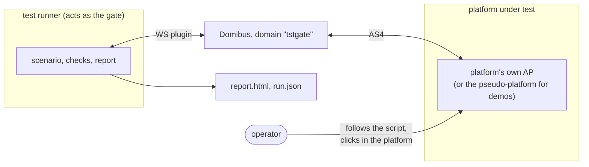
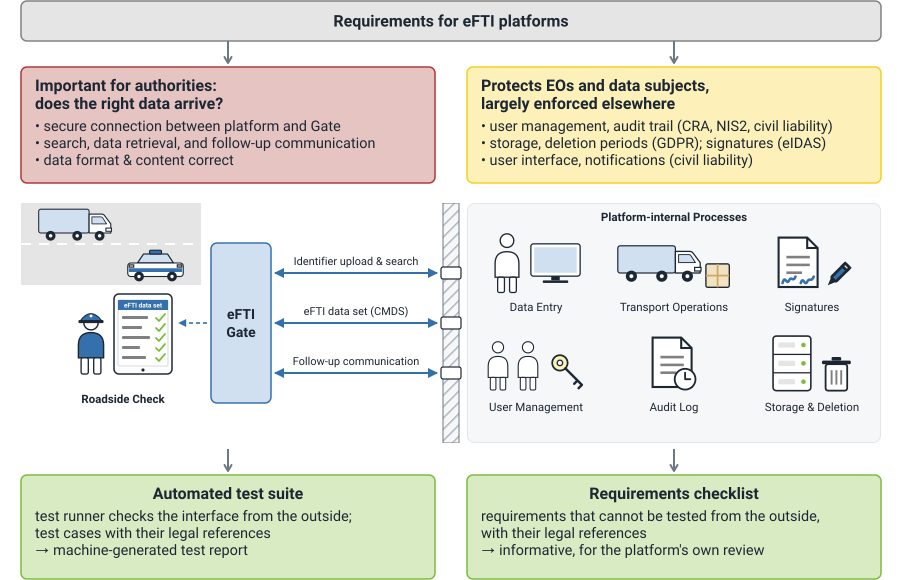

# eFTI Platform Connection Resources & Tests

This repository helps developers of **eFTI platforms** prepare for the connection of their platform to an **eFTI gate**.
It contains an automated test suite that checks whether a platform talks correctly to a gate over the
machine-to-machine interface (eDelivery/AS4) and produces an HTML test report, plus a checklist of the requirements
that cannot be tested from the outside (see [what this repository contains](#what-this-repository-contains)).

- **Platform developers** can run the test suite locally on their own machine, where the test runner plays the gate,
  to test their platform implementation before applying for a connection to a national eFTI gate.
- **Gate operators** may reuse the test runner (especially for the negative test cases) when testing a platform before connecting it to their gate, as well as the message format and exchange rule checks for continuous monitoring of production traffic.

New here and just want to run it? Go to **[GETTING_STARTED.md](GETTING_STARTED.md)**.

> [!WARNING]
> While running the test suite "as it is" will work out of the box, integrating another platform via eDelivery or
> WS plugin requires working knowledge of eDelivery and Domibus and the underlying infrastructure. 
> It will probably not work plug and play and may require adjustments to the platform's configuration, the Domibus setup, or the network configuration.
> If you don't know what you're doing, failure is likely.

> [!WARNING]
> **Proof of concept.** The code is entirely AI-generated and has not been thoroughly reviewed by a human. It
> illustrates how test reports could be generated in principle; its results are not yet a valid indication of whether the tested
> platform meets all requirements. **Further contributions to turn the test suite into something production-ready are highly appreciated!**

> [!NOTE]
> **Not official test cases.** The executed test cases are placeholders until eFTI4LIVE TG 2.5 has prepared refined test cases and/or the EU Commission has released the official technical conformance test (TCT) specification.

> [!NOTE]
> The tests are based on the message format of the eFTI reference
implementation (`formats/ri-v0.5`), they do not yet implement the new official eFTI XML schema (see [known limitations](#known-limitations)).

## How it works

The test runner plays the role of the gate. It has its own eDelivery access point (a Domibus domain) and
exchanges real AS4 messages with the platform's access point:



A test run has three parts:

1. **Lifecycle scenario (T-RUN-01..06)** per data set. An operator drives a prescribed synthetic data set
   through its life on the platform (create, carrier signature, correct a typo in the transport means identifier, consignee
   signature)
   following the [operator guide](testdata/README.md). The data sets of a run are chosen in `tst.yml` or on the
   command line and run one after the other. The runner waits for the identifier
   uploads the platform sends at each step and sends data requests and follow-up messages itself, as a normal gate
   does when a control officer requests data through their authority's application.
2. **Negative cases (T-NEG-02..10)**: before the consignee signature of the first activated data set, the runner injects faulty
   requests (schema-invalid, missing request ID, unknown data set, unknown data subset, foreign identifiers, unknown
   request ID) and, once two data sets are activated, a follow-up mixing them. It checks that the platform
   reacts with errors, never with data.
3. **Checks on every message (T-DAT-01..06, T-ALL-01..04)**: every message the platform sends during the run is
   checked for syntax (XSD), known values and status logic, identifier composition, subset filtering,
   consistency between uploaded identifiers and returned data, correlation and response time (T-ALL-04: data
   requests and follow-up acknowledgements).

The result is `report.html` (the test report, see [below](#what-this-repository-contains)) and `run.json` (all results plus the full
message transcript as evidence).

> [!NOTE]
> Testing TLS on the AS4 link (T-NEG-01) is not implemented yet; standard AS4 behaviour that a conformant eDelivery solution guarantees are not covered on purpose. Platform-internal and organisational requirements are listed in the [requirements checklist](#what-this-repository-contains).

## What this repository contains

The requirements for eFTI platforms fall into two groups, and the repository offers one resource for each (documents in `docs/`):



1. An **automated test suite** for the platform functionality that is observable over the wire at the gate. The test runner generates a test report with the result of every test case. All test cases (referred to by ID in the test report), incl. their legal references, are described in [`testcase-description.md`](docs/testcase-description.md).
2. A **requirements checklist**, i.e., an informative list of the other requirements that platforms legally have to fulfill and which are not observable at the gate, for the platform operator's own review: [`requirements-checklist.html`](https://raw.githack.com/EFTI4EU/platform-tests/main/docs/requirements-checklist.html).

Which test cases and checklist items address which requirements of the draft delegated act on the certification of eFTI platforms (draft of 21 October 2026 on the EU's "Have Your Say" platform) is shown in [`requirements-map.html`](https://raw.githack.com/EFTI4EU/platform-tests/main/docs/requirements-map.html).

## Repository layout

| Path | What it is |
|---|---|
| `core/` | Java library with the conformance checks, the format loader and the report (model, JSON, HTML). No Spring, no Domibus. This is what a gate can embed for monitoring. |
| `formats/ri-v0.5/` | Everything specific to one message format, in language-neutral files (see below). |
| `domibus-client/` | Small client for the Domibus WS plugin (web service interface for submitting and fetching messages) in pull mode (submit, fetch pending, mark downloaded, AS4 receipt status); at-least-once, no message is lost if a client crashes during a test run. |
| `runner/` | The test runner CLI: scenario, fault injection, operator prompts, result evaluation. |
| `pseudo-platform/` | A minimal platform with a web UI, to try the runner without a real platform and to demonstrate failures (fault toggles). |
| `deploy/` | Docker stack: MySQL, Domibus (domains `tstgate` and `pseudoplatform`), pseudo-platform, runner, and `tst.sh` (start/stop, onboarding, test runs) with its helper scripts. |
| `testdata/` | Format-independent: the operator guide, the catalogue of test data sets (`datasets.yml`, with their subsets) and the values of each. |
| `docs/` | The test case description, the requirements checklist, and the requirements map (see above). |

## Message formats are kept at the edges

The message format will change once the official eFTI XML schema is ready to replace the reference implementation's
schema. The Java code is therefore kept as independent as possible from the specific format and never names XML elements directly. Everything format-specific is contained in
`formats/<version>/`:

| File | Purpose |
|---|---|
| `xsd/` | The message and data set schemas (checked in T-DAT-01; the subset annotations drive subset filtering). |
| `format.properties` | Root element per message kind, XPaths for all fields, status code meanings, identifier definitions, fields ignored in the round trip, the code of road transport, what a test case cannot evaluate in the format (shown as a note in the report). |
| `schematron/messages.sch` | Rules on single messages, each tagged with its test case ID (e.g. status logic, mode of transport present). |
| `templates/*.xml` | All messages the runner and the pseudo-platform send, incl. the fault-injection variants. |
| `testdata/*.xml` | The full test data sets with all values in this format (for platforms that support direct imports of XML files). |
| `platform/` | Format-specific helpers of the pseudo-platform only. |

Ideally, to support a new XML format version it should therefore be enough to add a sibling folder next to `formats/ri-v0.5` and point the configuration to it. Code
changes are only needed if the new format brings new concepts (e.g. attachments in follow-ups) or XSD constructs
the subset model does not support yet (e.g. `xsd:choice`; loading such a format fails instead of building a wrong
model). `FormatContractTest` checks every format folder automatically (templates, test data, identifier
definitions, and that the markdown in `testdata/` holds every value of the XML test data that the platform does not
set itself); the check logic itself is tested against a small synthetic format (`core/src/test/resources/formats/mini/`),
so these tests are independent of the real message format.

## Integrating the checks in a gate for continuous monitoring

A platform that passed the test suite can still break later, e.g. after an update. To notice this, a gate can run the
checks that the test runner applies to every message (T-DAT-01, T-DAT-02, T-ALL-03, T-ALL-04) on its production traffic
with a connected platform. 

These checks are in the `core` module, a plain Java library without Spring or Domibus (build it with
`./mvnw -pl core -am install`, then add `eu.efti.tst:core` as a dependency). A gate would then call it in three places:

**1. Once per connected platform**, set up what the checks need to know:

```java
Format format = Format.load(Path.of("formats/ri-v0.5"));   // the message format the platform uses
MessageHistory history = new MessageHistory(format);
ConformanceContext context = new ConformanceContext(gateId, platformId,
        ConformanceContext.LEGAL_RESPONSE_TIMEOUT, ConformanceContext.Mode.MONITORING);
```

- `MessageHistory` remembers the messages exchanged with this platform, since many checks compare a message with
  earlier ones (e.g. a response with its request). Keep one per platform.
- `ConformanceContext` holds the gate ID, the platform's registered ID (both compared with the IDs in the platform's
  messages) and the time within which the platform must answer a data request or acknowledge a follow-up.
  `Mode.MONITORING` leaves out the checks of the composition and consistency of the data (T-DAT-03 to T-DAT-05):
  they depend on the consignment, whose content the gate does not judge in production.

**2. For every AS4 message exchanged with the platform**, in both directions, check it and record it in the history:

```java
MessageRecord record = new MessageRecord(as4MessageId, timestamp, MessageRecord.Direction.FROM_PLATFORM,
        fromParty, toParty, conversationId, refToMessageId, payloadXml);
CheckedMessage checked = ConformanceChecks.checkAndAppend(record, history, context);
checked.findings().forEach(this::report);   // e.g. log or alert
```

- A `MessageRecord` holds what any AS4 access point knows about a message: IDs, parties, conversation ID,
  RefToMessageId, direction, timestamp and the XML payload.
- The gate's own messages (data requests, follow-ups and the upload statuses it answers identifier uploads with)
  must be appended too (`Direction.TO_PLATFORM`). They yield no findings, but the checks of the platform's answers
  refer to them.
- Responses are paired with requests by their AS4 RefToMessageId, which a platform must set to the AS4 message ID
  of the request (TGD Annex 1 ch. 3; a response without it fails T-ALL-03). Only without it, the pairing falls back
  to the AS4 conversation ID and then to the echoed request ID, which every response must carry as well.
- A `Finding` names the violated test case, the AS4 message ID it refers to and what is wrong.
- `checkAndAppend` is thread-safe, so it may be called from several receiving threads with the same history.

**3. Periodically** (e.g. every minute), report requests the platform never answered, then drop old messages so
the history does not grow without limit:

```java
ConformanceChecks.checkOverdue(history, Instant.now(), context).forEach(this::report);
history.prune(Instant.now().minus(Duration.ofHours(1)));
```

`checkOverdue` keeps no state: every call reports all requests that are overdue at that time, so an unanswered
request is reported again on each call until it is pruned. Report a finding only once per test case ID and AS4
message ID.

Prune only messages well older than the response timeout: a pruned request is no longer reported as overdue, and a
late answer to it is reported as unsolicited. The last accepted identifier upload of every data set is kept, as a
test run compares the data responses with it.

Gates not written in Java can still reuse the language-neutral parts in `formats/<version>/` (XSD, Schematron,
XPaths).

## Known limitations

- **Gaps in the current XML format (`ri-v0.5`);** the report states those of T-DAT-01, T-DAT-02, T-DAT-03,
  T-ALL-03, T-NEG-04, and T-NEG-08 as a note on the test case, since their PASSED currently covers less than their description:
  - The platform's messages carry neither the gate and platform identifier nor a timestamp, and its responses no data set ID, so T-DAT-02 checks only the status logic.
  - For the same reason a success response cannot carry the foreign gate or platform identifier of a request, so
    T-NEG-04 and T-NEG-08 only check that the platform answers.
  - Messages have no message instance ID (eFTI1), so T-ALL-03 checks the uniqueness of the AS4 message IDs and of the request IDs of identifier uploads instead.
  - Identifier uploads cannot carry some fields the registry of identifiers requires according to the technical
    guidance (type code of the transport means, category of the carried equipment, countries of acceptance and
    delivery). T-DAT-03 only requires the mode of transport and the dangerous goods indicator in every upload.
  - Follow-up communication messages have no attachments, so T-RUN-05(b) is not applicable.
  - Follow-up messages are only acknowledged by the platform; in the future they should also be answered with a
    response similar to the eFTI data response.
  - Field lengths and code lists are only checked as far as the XSD enforces them (T-DAT-01), e.g. a transport
    document type code of `999` is accepted. Allowed date format codes per element are not checked either, except
    that format 203 is rejected on the carrier acceptance and actual delivery dates. Test runs catch deviating
    values through the round trip (T-DAT-06) where it compares them; production monitoring does not.
- **The new official eFTI XML schemas (FTI004..FTI030) are not implemented yet** as they are still a beta version with open issues, e.g. the identifier upload
  (FTI004) holds one separate list per field instead of one entry per transport equipment: for two trailers uploaded
  as IDs `[A, B]` and registration countries `[DE, PL]`, which country belongs to which trailer is not recorded, so a
  platform that mixes them up sends a valid upload. Their code lists are not settled yet either. **The test suite will
  switch to the new format version once the reference implementation of the eFTI Gate does too, so that both stay in sync.**
- **Conditional data elements are not checked directly:** the Delegated Regulation (EU) 2024/2024 states their
  conditions only as free text, so no schema can encode them. Test runs cover them through the round trip with the
  known data set (T-DAT-06); production monitoring has no expected data, so there they cannot be checked.
- **Plain HTTP:** the local AS4 link has no TLS, so T-ALL-01 does not verify TLS and T-NEG-01 is not run.

## Development

Requires Java 21. Build and run all tests:

```
./mvnw verify
```

The live smoke test of the Domibus client runs only against a started stack. It pulls the messages of both
domains itself, so stop the pseudo-platform first (it would fetch the test's messages) and let no test run go on
at the same time:

```
docker compose -f deploy/docker-compose.yml stop pseudo-platform
./mvnw -pl domibus-client -am verify -Dtst.domibus.url=http://localhost:18080/domibus/services/wsplugin
sh deploy/tst.sh start   # starts the pseudo-platform again
```

## License

Apache License 2.0, see [LICENSE](LICENSE). Third-party files in this repository keep their own license, in particular
the Domibus database scripts in `deploy/db/ddl/` (EUPL 1.2); [NOTICE](NOTICE) lists them.
