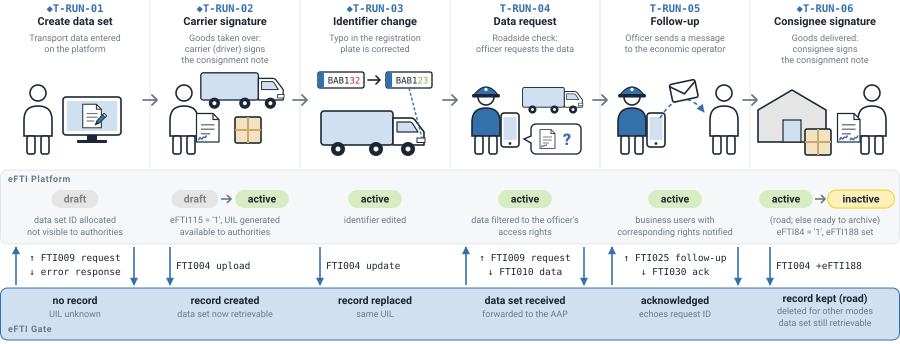

# Automated Test Suite: Test Case Descriptions

Description of the test cases of the test suite in this repository: automated testing of the machine-to-machine interface of an eFTI platform by a test runner that plays the role of an eFTI Gate.

> [!NOTE]
> **Test report:** each test run produces a test report, generated automatically by the test runner. It follows the structure of this description and lists every test case by its ID and title with its result (per data set where the section says so), together with the metadata of the run (platform, test data sets used, start and end of the run), the findings of failed test cases, and the transcript of the exchanged messages.

> [!NOTE]
> **Not official test cases:** the test cases described here are placeholders. The final test cases are to be devised by eFTI4LIVE TG 2.5 and/or the EU Commission (DG MOVE) to ensure that all Member States use a harmonised set. 

## 1 Test setup and methodology

The test runner plays the role of an eFTI Gate and tests the platform from the outside, i.e. exclusively via the machine-to-machine interface (eDelivery/AS4) and the messages exchanged over it. The focus is on the interface operations observable "on the wire": the registration of data sets in the Gate's registry of identifiers, request/response cycles for eFTI data, follow-up communication, and the conformance of every message and every transmitted data set with the eFTI specifications (message schema, common data set of Delegated Regulation (EU) 2024/2024). Of the connection itself, the test verifies that it is secured and works end to end (T-ALL-01, T-ALL-02, T-NEG-01).

- **Choreographed steps** (marked with ◆) require an action by a platform operator following the script; they are limited to the four actions that drive a data set through its lifecycle: creating the data set from the prescribed test data, applying the carrier signature, correcting a typo in the identifier of the transport means (e.g. the registration plate), and applying the consignee signature. The only manual data entry is the data set ID after creation (the test runner cannot learn the ID of a draft by itself, since no UIL exists yet). Verification of every result is automatic.
- **Test data:** only the prescribed synthetic test data sets are used; no real personal data is processed.
- **Gate connection standard:** the test covers only the standard eDelivery interface (Art. 12(1)(a) of Impl. Reg. (EU) 2025/2243; Art. 9(3) of Impl. Reg. (EU) 2024/1942). Equivalent nationally defined message exchange specifications (e.g. a REST interface) under Art. 9(4) of Impl. Reg. (EU) 2024/1942 are not tested.
- **Out of scope of this test:** all platform-internal and organisational requirements (user management/IAA, HMI, operations log content, retention, deletion, backups, status assignment, etc.). These are listed in the accompanying [requirements checklist](https://raw.githack.com/EFTI4EU/platform-tests/main/docs/requirements-checklist.html).
- **Continuous monitoring:** the checks of the message format (T-DAT-01, T-DAT-02) and the test cases of section 2.3 are formulated independently of the test data so that the Gate can re-evaluate them on every production exchange. A platform update that starts producing malformed messages is thereby caught by the same checks that were passed here.
- **Naming of data fields:** data elements are named as in the regulations (e.g. eFTI188, the actual delivery date), not by the element names of the XML message schema, since a revision of the schema is announced.

<b>Quick reference: messages, identifiers, and terms used in this description</b>

| Term | Meaning |
|----|----|
| FTI004 | **Upload identifiers** (platform → Gate). Registers or updates a data set in the Gate's registry of identifiers: carries the UIL plus the set of identifiers of the data set. Sent by the platform on carrier signature (activation), whenever an identifier of an active data set changes, and on consignee signature (actual delivery date). |
| FTI029 | **Upload response** (Gate → platform). Result of an FTI004: status code, and an error description if the upload was not accepted. |
| FTI009 | **eFTI data request** (Gate → platform). Requests one data set, identified by its UIL. Carries the end-to-end transaction ID (eFTI1794, the request number issued by the authority access point; called "request ID" in this description), the access rights of the CA officer as a list of data subsets, and the country of the requesting authority. |
| FTI010 | **eFTI data response** (platform → Gate). Echoes the request ID, carries its own message instance ID (eFTI1) and a status code (C = complete, E = error, P = pending, T = timeout, U = unauthorised); on success the requested data set restricted to the requested subsets, otherwise an error description (error text, optionally with an error code). |
| FTI025 | **Follow-up communication** (Gate → platform). Message of a CA officer to the economic operator: free text, one or more attached files (PDF, JPEG, PNG, or TXT), or both, as provided by the message specification implementing Art. 3(5)(a) of Impl. Reg. (EU) 2024/1942; refers to a previous data request by request ID and UIL. |
| FTI030 | **Follow-up acknowledgement** (platform → Gate). Status of the processing of an FTI025, echoing the request ID of the data request the follow-up communication refers to. |
| AS4 receipt | Signed acknowledgement of receipt at eDelivery level, returned for every accepted message (independent of the business response above). |
| Data set ID / UIL | The **data set ID** is the unique identifier the platform allocates to a data set on creation, in UUID format (Art. 11(2)(c) of Impl. Reg. (EU) 2024/1942; the message specifications require RFC 9562 version 4). The **UIL** (unique identifying link) is composed of Gate identifier + platform identifier + data set ID and is generated on carrier signature (Art. 11(2) of Impl. Reg. (EU) 2024/1942). |
| Identifiers, RoI | The **registry of identifiers (RoI)** of the Gate maps each UIL to the identifier set of Art. 11(3) of Impl. Reg. (EU) 2024/1942: transport means (eFTI618, eFTI620), transport equipment (eFTI374, eFTI378, eFTI578, eFTI987), carried equipment (eFTI448, eFTI1000), carrier acceptance date (eFTI39), actual delivery date (eFTI188), mode of transport (eFTI581), and the dangerous goods on board indicator (eFTI1451). The technical guidance extends this list (e.g. the transport-means type code, the loading and unloading dates, and the corresponding country codes) and uses a different code for the dangerous goods indicator (eFTI1855); the tests refer to the identifiers by meaning. |
| Data subsets | Groups of data elements corresponding to one regulatory information requirement (Del. Reg. (EU) 2024/2024, Sections 3 and 4), e.g. EU01 = Reg. No 11 (carriage conditions), EU02 = Directive 92/106/EEC (combined transport), EU03 = Reg. (EC) No 1072/2009 (cabotage), EU05a = ADR (dangerous goods by road). A data set is composed of the subsets applicable to the consignment movement; CA officers' access rights are expressed as a list of subsets. |
| Other codes | eFTI581 = mode of transport ('3' = road); eFTI1451 = dangerous goods on board; eFTI188 = actual delivery date; eFTI115 / eFTI84 = carrier / consignee signature indicators. |

### 1.1 Test data sets

One test data set is prepared per transport mode to be tested; the dangerous goods and waste variants are built on top of a mode data set rather than as separate ones. The data sets of a run are selected when it is started and run one after the other in the requested order, each once through the full lifecycle scenario of section 2.1; a dangerous goods variant can be run together with the corresponding transport mode data set or on its own. The result of every requested data set counts towards the overall test result. A failed step ends the run of that data set and the next one starts. If the test run itself stops (interrupted, operator not responding, outage of the access point), the test report covers the data sets that went through and names those requested but not completed, and it cannot pass. Section 1.1 of the test report lists all data sets with whether they were requested and a summary of their results in sections 2.1 and 2.2; section 2 shows only the requested ones. Each data set comprises the data subsets of its profile; where these are several, they share data elements, so that subset filtering and normalisation can be observed. The test data are minimal: mandatory elements and the conditional elements whose condition is met, no optional elements except the name of the consignor, which Art. 6(1) of Regulation No 11 requires. Besides the elements of its subsets, every test data set contains all elements of the common data set that the identifier upload uses (e.g. the mode of transport eFTI581 and, after consignee signature, the actual delivery date eFTI188): the identifier upload draws on the common data set independently of the subsets, which only determine what a data response returns to competent authorities. Selected data elements are additionally filled to their maximum permitted field length (format notation of Del. Reg. (EU) 2024/2024, e.g. free-text elements), so that truncation or padding by the platform shows up in the round-trip comparison (T-DAT-06). One of these elements and one element that the platform must return contain a non-ASCII character (a German umlaut), so that losses from character encoding conversions show up as well.

| ID | Test data set | Content |
|----|----|----|
| DS1 | **Road (basic road, P01)** | synthetic international road consignment in combined transport: subsets EU01 and EU02 (the subsets of profile P01, R-D1-01 of the draft delegated act), mode of transport = road, no dangerous goods |
| DS1C | **Road cabotage** (optional) | synthetic international road consignment including a cabotage operation: subsets EU01 and EU03 (overlapping), mode of transport = road, no dangerous goods |
| DS2 | **Rail (basic rail, P02)** | synthetic rail consignment: subset EU01, mode of transport = rail, no dangerous goods |
| DS3 | **Inland waterways (basic inland waterways, P03)** | synthetic inland waterway consignment: subset EU01, mode of transport = inland waterway, no dangerous goods |
| DS4 | **Air (basic aviation, P04)** | synthetic air consignment: subset EU06, mode of transport = air |
| DS1-DG, DS2-DG, DS3-DG | **Dangerous goods variants (P05)** | variant of the road, rail, or inland waterway data set (profiles P05 and P06 build on P01–P03 only, Art. 7(4) of the draft delegated act; no air variant): dangerous goods on board plus the corresponding subset EU05a (ADR), EU05b (RID), or EU05c (ADN) |
| W | **Waste shipments variant (P06)** | variant of the road, rail, or inland waterway data set: waste shipment documents plus DIWASS exchange (once available, see below) |

> [!NOTE]
> **Road cabotage (data set DS1C):** the cabotage subset EU03 (Art. 2(1)(a)(iii) of Regulation (EU) 2020/1056) is not covered by any profile of the draft delegated act. The corresponding test run is therefore optional, and recommended when testing road. Once requested it counts like any other data set: its findings fail the test case.

> [!NOTE]
> **National data subsets:** the test data sets contain only EU data subsets. National subsets (Section 4 of the Annex to Del. Reg. (EU) 2024/2024) are not tested; supporting them correctly remains the responsibility of the platform operator.

> [!NOTE]
> **Waste shipments (data set variant W):** not available yet. The eFTI data subset for waste shipments (Art. 2(1)(a)(iv) of Regulation (EU) 2020/1056) has not been adopted (as of October 2026): Delegated Regulation (EU) 2024/2024 deliberately leaves it out (recital (5)), so there are no data elements against which the R-D3 data conformance checks could be run. Once the subset is available and the variant is requested, it will run the full lifecycle scenario of section 2.1 including the R-D3 data conformance checks of section 2.2. The waste-specific requirements (R-S1 to R-S3) are not observable at the Gate — R-S1 concerns the platform's connection to DIWASS, R-S2 and R-S3 the platform-internal handling of waste shipment documents and carrier transfer confirmations — and are therefore not part of this test; they are listed in the [requirements checklist](https://raw.githack.com/EFTI4EU/platform-tests/main/docs/requirements-checklist.html) (items W-01 to W-03).

## 2 Test cases

The suite is structured the way it is executed:

- **2.1 Lifecycle scenario** — one parametrised scenario, executed once per prepared data set of section 1.1. Its steps run in the listed order; each step depends on the state produced by the previous ones and carries the assumptions verified at that point. The test report records one result per data set.
- **2.2 Data conformance checks** — evaluated on every message the platform sends during a data set's run; reported per data set, because the applicable data subsets and therefore the expected content differ. T-DAT-01 and T-DAT-02 are designed to be re-used for continuous monitoring in production.
- **2.3 Exchange rule tests** — evaluated automatically on every message exchange of every scenario run, independent of the data set; not implemented as separate scenarios. Also designed for continuous monitoring.
- **2.4 Negative test cases** — standalone tests with dedicated invalid inputs, not parametrised; grouped by the aspect they probe. The data-access and follow-up cases run once against the primary data set (the first data set activated during the run) before its consignee signature (T-RUN-06), while it is still active, T-NEG-01 needs no data set, and T-NEG-10 runs once two data sets have been activated, before the consignee signature of the second. No operator action is needed for any of them.

The reference line of each test case names the underlying legal provision and, where available, the corresponding specified requirement (R-…) of Annex I of the draft delegated act on the certification of eFTI platforms (draft of 21 October 2026 on the EU's "Have Your Say" platform); the [requirements map](https://raw.githack.com/EFTI4EU/platform-tests/main/docs/requirements-map.html) shows this mapping at a glance. Article references without further specification refer to Implementing Regulation (EU) 2025/2243. Where an expectation rests on the technical guidance documents (TGD) rather than on regulation text, this is stated.

### 2.1 Lifecycle scenario (per data set)

Executed in this order for each prepared data set. Steps marked ◆ are performed by the platform operator following the script; the test cases listed with each step are verified automatically by the test runner before the run proceeds to the next step, and a step failure aborts the data set's run. Every message produced during the scenario is additionally subject to the data conformance checks of section 2.2 and the exchange rule tests of section 2.3; those do not abort the run. The messages exchanged are the same for all transport modes; only the mode-dependent status assignment at consignee signature (Annex points (g)(5), (6); not observable on the wire) and the Gate's own handling of the registry record at the end of the transport differ, so the final retrievability check is made for road data sets only.

Lifecycle of one eFTI data set as driven by the scenario:

| ID | Test case |
|----|----|
| T-RUN-01 | **◆ Create data set — draft not visible to authorities** The test operator creates the data set from the prescribed test data and enters the data set ID displayed by the platform in the test portal (the only manual data entry of the whole test). Expectation: a data request from the test runner for a UIL constructed from that data set ID is answered with an error response and never with the data: no status that makes the data set available to competent authorities has been assigned yet (Annex points (a)(2), (f)(5)), the draft is not registered in the Gate's registry of identifiers, and the platform returns an error message where it cannot serve a request for business process reasons (Art. 3(2)(d)(ii)). The regulation itself does not prohibit serving a draft (Annex point (f)(5) only requires availability once the data set is active); the "never with the data" expectation rests on TGD2 ch. 6.1 (a draft is not yet made available to competent authorities, guidance). *Reference: Annex points (a)(2), (f)(5); Art. 3(2)(d)(ii); TGD2 ch. 6.1 (guidance) · R-G2-04 (i), R-G4-12 (i)* |
| T-RUN-02 | **◆ Carrier signature — activation and registration** The test operator acts as the carrier taking over the shipment and applies the carrier signature to the data set on the platform. Expectation: the platform sends an identifier upload for the data set to the test runner and the runner accepts it; the UIL in the upload consists of the Gate identifier of the test runner, the platform's own identifier, and the data set ID entered in T-RUN-01; the identifier set passes the test runner's validation (the same validation the production Gate may apply) and carries the values prescribed by the test data, in particular the identifier of the transport means, the mode of transport, and the dangerous goods indicator ('No' for the mode data sets, 'Yes' for the DG variant). The carrier acceptance date must be present (its format is part of the Gate's validation) but is not compared with the test data, since a platform may set it to the time of the carrier signature. Which identifiers the set must contain: T-DAT-03. *Reference: Annex point (f)(4); Impl. Reg. (EU) 2024/1942 Art. 11(1)–(3); TGD Annex 1 ch. 4 (guidance) · R-G4-10, R-G4-11 (i), (ii)* |
| T-RUN-03 | **◆ Identifier change on the active data set** The test operator corrects a typo in the identifier of the transport means (e.g. the registration plate of a truck); the transport means itself is unchanged. Expectation: the platform sends an identifier update for the same, unchanged UIL carrying the complete identifier set with the corrected value (the Gate replaces the registry record as a whole, so a partial set would drop identifiers — TGD1 ch. 6.1, guidance; Annex point (b)(4) itself requires only the update of the affected identifier values, so the full-set criterion rests on the guidance). The identifier of the transport means is exercised as a sample of the identifiers that can change while the data set is active. *Reference: Annex point (b)(4); TGD1 ch. 6.1 (guidance) · R-G4-04 (i)* |
| T-RUN-04 | **Data request by the competent authority** The test runner sends two valid data requests for the UIL, or only request (a) if the data set has a single subset: (a) with access rights covering all subsets contained in the data set (e.g., DS1: EU01 and EU02; DS1C: EU01 and EU03); (b) with access rights covering only one subset (e.g., DS1, DS1C: EU01). Expectation: (a) the response has success status and contains the full data set, reflecting the value corrected in T-RUN-03 where it contains the identifier of the transport means (the identifier is not part of EU06 and is optional in EU01 and EU02, so a response may lack it there; the report then notes that the corrected value was not compared); (b) the response contains only data elements of that subset, no element outside this subset is returned. Which elements each response must contain (normalisation, completeness): T-DAT-04. *Reference: Art. 3(2)(b), (d)(i); Art. 8(2) · R-G2-02, R-G2-03* |
| T-RUN-05 | **Follow-up communication** The test runner sends two valid follow-up communications referring to request (a) of T-RUN-04 (request ID and UIL known to the platform): (a) with a free-text content filled to the maximum text length permitted by the message specification plus one attached PDF document, so that correct handling of full-length fields and of attachments is exercised; (b) with an attached document only (the text is optional in the message specification). Expectation: the platform acknowledges each of them to the requesting Gate with success status; each acknowledgement refers to its follow-up communication by the AS4 RefToMessageId (both follow-up communications refer to the same data request, so only this distinguishes the acknowledgements) and echoes the request ID of the data request the follow-up communication refers to; the subsequent scenario steps complete normally. (The notification of the business users concerned and the unabridged recording of the content are not observable at the Gate; requirements checklist items NTF-02 and LOG-02.) *Reference: Art. 3(2)(f)(i), (iii); TGD Annex 1 ch. 3 (guidance) · R-G2-05, R-G2-07* |
| T-RUN-06 | **◆ Consignee signature — end of the transport operation** The test operator acts as the consignee receiving the shipment and applies the consignee signature to the data set on the platform. Expectation: the platform sends an identifier update for the UIL that now carries the actual delivery date (eFTI188); the test runner accepts it; a real Gate then applies its own registry rules (road: record kept until the cabotage period of Art. 11(4) of Impl. Reg. (EU) 2024/1942 has elapsed, then deactivated and deleted; other modes: deactivated and deleted at once — Gate behaviour, not checked against the platform). A subsequent data request for the UIL still returns the data set; checked for road data sets only (eFTI581 = '3'), where the platform assigns the status 'inactive' upon the consignee signature and Art. 9(6) requires online availability to competent authorities. Non-road data sets go straight to 'ready to archive', for which Art. 9(7) requires accessibility but not the online channel; in this case the test does not verify that the data is no longer returned. The status assignment itself is not observable on the wire (requirements checklist item DATA-06). *Reference: Annex points (g)(4)–(6); Art. 3(2)(d)(i), Art. 9(6), (7), Art. 11; Impl. Reg. (EU) 2024/1942 Art. 11(3), (4); TGD1, TGD2 ch. 6.1 (guidance) · R-G4-04 (ii), R-G4-12, R-G6-01* |

### 2.2 Data conformance checks (per data set)

Evaluated on the messages the platform sends during a data set's run rather than as separate scenarios; reported per data set, because the applicable data subsets and therefore the expected content differ. The tests build on each other: syntax of every message (T-DAT-01), known values and status logic of every message (T-DAT-02), the content rules specific to identifier uploads (T-DAT-03) and data responses (T-DAT-04), consistency across the messages of a data set (T-DAT-05), and finally the 1:1 comparison with the known test content (T-DAT-06). T-DAT-01 and T-DAT-02 are the checks the Gate can also apply to production traffic for continuous monitoring.

| ID | Test case |
|----|----|
| T-DAT-01 | **Syntactic validity** `all messages` Can the message be parsed? Every message the platform sends is well-formed XML and valid against the applicable eFTI message schema, including the embedded identifier set or data set: all mandatory fields present, every value of the prescribed data type, format, and field length (UUIDs per RFC 9562 as required by the message specifications, timestamps, numbers, dates; character type and fixed or maximum length incl. decimal precision per the format notation in Section 1, point 7, of the Annex to Del. Reg. (EU) 2024/2024, e.g. 'an..6'), coded values taken from the assigned code list. *Reference: Art. 8(3); Art. 12(3); Impl. Reg. (EU) 2024/1942 Art. 9(1); Del. Reg. (EU) 2024/2024; TGD Annex 1 ch. 2 (message specifications, guidance) · R-G1-03, R-G2-03 (iii), R-G2-04 (v), R-G2-07 (ii), R-G4-02 (iv), (v), R-D1-01 … R-D3-03 (i), (iii)* |
| T-DAT-02 | **Known values and status logic** `all messages` Does the message carry the values that are known in advance? The platform identifier is the platform's registered identifier, the Gate identifier is that of the test runner, the data set ID is the one of the data set concerned (for responses: the requested one); the message timestamp lies within the tolerance the test runner applies to its own clock (test convention; the timestamp field itself is defined by the message specifications). Status codes are values of the status code list of the message specifications (TGD Annex 1 ch. 2, guidance); a data response with status 'complete' carries the data set and no error description, any other status carries no data set (test convention). Only status 'error' requires an error description (error text, optionally with an error code), as Art. 3(2)(d)(ii) prescribes for error messages; for the other statuses and for follow-up acknowledgements, the message specification only says that one *should* be provided, so a missing one is not a failure. *Reference: Art. 3(2)(d)(ii); Impl. Reg. (EU) 2024/1942 Art. 3(3)(a), (b), Art. 11(2); TGD Annex 1 ch. 2 (guidance) · R-G2-04 (iv)* |
| T-DAT-03 | **Composition of the identifier set** `identifier upload / update (FTI004)` Which identifiers does an upload contain? All identifiers of Art. 11(3) of Impl. Reg. (EU) 2024/1942 for which the data set holds a value are present, the mode of transport always among them (TGD Annex 1 ch. 4, guidance), as is the dangerous goods indicator, which the platform derives (Art. 11(3)(b)), and so are the fields the registry of identifiers requires (TGD Annex 1 ch. 4, guidance). Every update transmits the full set, not only the changed identifier, since the Gate replaces the registered set as a whole (TGD1 ch. 6.1: 'the new identifiers set must replace the old ones (not merge)', guidance; Annex points (b)(4) and (g)(4) themselves require only the affected identifier to be updated). An upload does not show which identifiers the data set holds, so this test case itself only checks the identifiers every upload must contain (mode of transport, dangerous goods indicator). Whether an upload is complete is checked where the content of the data set is known: in the test run by the lifecycle steps, which compare the upload they are evaluated on with the test data (T-RUN-02, T-RUN-03, T-RUN-06), and in production monitoring by the comparison with the returned data sets (T-DAT-05). (Formats: T-DAT-01; agreement with the data set: T-DAT-05.) *Reference: Annex points (b)(4), (f)(4), (g)(4); Impl. Reg. (EU) 2024/1942 Art. 11(3); TGD Annex 1 ch. 2, ch. 4, TGD1 ch. 6.1 (guidance) · R-G4-04 (i), R-G4-11 (i), (ii)* |
| T-DAT-04 | **Composition of the returned data set** `data response (FTI010)` Which data elements does a response contain? The union of the data elements of all subsets listed in the access rights of the request (TGD2 ch. 6.2, guidance): each element is returned once, even if it belongs to several requested subsets; the response contains no element outside the requested subsets. Every mandatory element is always included, with an empty value if the economic operator did not provide one (TGD2 ch. 6.2, guidance), as is every conditional element whose condition is met (legal status per Sections 3 and 4, business rules per Section 6 of the Annex to Del. Reg. (EU) 2024/2024). This test case checks the mandatory elements. In the test run, where the test data fill every mandatory element, each of them must carry a non-empty value; a missing or empty mandatory element fails regardless of whether the platform dropped it on the way (mapping loss) or never flagged it in the input validation of Annex point (b)(3). In production monitoring an element that is present but empty is a data-quality finding against the economic operator, not a platform failure. Conditional elements are not checked by this test case, since Del. Reg. (EU) 2024/2024 states their conditions only as free text: in the test run a missing or changed one fails the round trip (T-DAT-06), except for the values the platform assigns itself; in production monitoring they are not checked. *Reference: Art. 3(2)(d)(i); Art. 8(2); Annex point (b)(3); Del. Reg. (EU) 2024/2024; TGD2 ch. 6.2 (guidance) · R-G2-03, R-D1-01 … R-D3-03 (i), (ii), (iv)* |
| T-DAT-05 | **Consistency of identifier values across messages** `identifier upload (FTI004) / data response (FTI010)` Are the identifier values registered at the Gate equal to those in the data set returned by the platform? The identifier values the platform uploaded to the registry are compared with the corresponding values in the full data set it returns (transport means and equipment, carried equipment, dates); they must be equal in value (e.g. the same instant with another UTC offset is equal, while a different date format code is not). Identifiers outside the requested subsets are not part of a data response (e.g. the mode of transport eFTI581 is not part of EU01 or EU03, the actual delivery date eFTI188 is part of EU03 only); they and the dangerous goods indicator (derived by the platform, not a data set element) are compared only where the returned data set contains them. An identifier with legal status 'optional' in all requested subsets may be missing as well (TGD2 ch. 6.2, guidance, see T-DAT-06); any other registered identifier missing from the response is a failure. Detects a platform whose uploaded identifier values no longer match the data it actually holds (e.g. an update path that changed the data set but forgot the identifier update), which would make the Gate's registry misleading for authorities' searches. *Reference: Annex points (b)(4), (f)(4); Impl. Reg. (EU) 2024/1942 Art. 11 · R-G4-04, R-G4-11* |
| T-DAT-06 | **Round-trip of the prescribed test content** `test only` Since the test data are known exactly, every data response is compared 1:1 with the expected data set (all fields except the variable ones such as timestamps and message identifiers, except the values the platform assigns itself, i.e. the signature and stamp statement codes of Annex points (e)(3) to (h)(3), the carrier acceptance date, and the actual delivery date, and except data elements with legal status 'optional', which a platform may omit from a response per TGD2 ch. 6.2, guidance): the values entered by the operator per the script arrive unchanged and complete — no conversion or mapping losses, e.g. with upstream legacy data models. Values are compared as their data type in the message schema defines them: numbers by value (e.g. 12500.000 equals 12500); dates and codes without regard to surrounding whitespace; free text exactly, including whitespace, so that padding shows up. Characters that differ only in their Unicode normalization form (e.g. an umlaut as one character or as a letter with a combining mark) are equal. An attribute that the platform adds to a value of the test data set (e.g. the language of a text) does not fail the test but is listed in the report (informative); a changed or missing attribute fails like any other value. The regulation is stricter than the guidance on optional elements: a response consists of "all the data elements that correspond to the applicable regulatory information requirements" (Art. 3(2)(d)(i); Art. 8(2)), and the legal status 'optional' of Del. Reg. (EU) 2024/2024 only makes it optional for the economic operator to provide the element. Optional elements that the test data set contains but the platform did not return therefore do not fail the test but are listed in the report (informative). The only test case that depends on the prescribed test content. *Reference: Art. 3(2)(d)(i); Art. 8(2); TGD2 ch. 6.2 (guidance) · R-G2-03 (i), (ii)* |

### 2.3 Exchange rule tests (run-wide)

Evaluated automatically on every message exchange of every scenario run, independent of the data set; not implemented as separate scenarios. All of them can be applied to production traffic for continuous monitoring.

| ID | Test case |
|----|----|
| T-ALL-01 | **eDelivery/AS4 connection** Every exchange of the run takes place as a four-corner eDelivery exchange whose Access Point leg runs between the platform's eDelivery Access Point and the test runner's Access Point, over TLS 1.2 or higher (TGD2 ch. 4.5.1, guidance) and with the AS4 message-level signature and encryption prescribed by the eFTI eDelivery profile (TGD Annex 1 ch. 3); every message the platform accepts is acknowledged with a signed AS4 receipt (observed as evidence of the working connection; the receipt mechanism itself is presupposed, requirements checklist item CON-01). That the connection is sustained over time is shown within the run and afterwards by the continuous monitoring of production traffic. *Reference: Art. 3(1), Art. 12(1)(a), (3); TGD Annex 1 ch. 3 (eDelivery profile, guidance); TGD2 ch. 4.5.1 (guidance) · R-G1-01 (i), (ii), (iv)* |
| T-ALL-02 | **Acceptance of validly signed Gate messages** Every message signed with the valid security certificate of the test runner's Access Point is accepted and processed. *Reference: Art. 3(2)(a); Art. 12(1)(b) · R-G1-02a (i), R-G2-01 (i)* |
| T-ALL-03 | **Correlation and uniqueness** A response is correlated with its request by the AS4 RefToMessageId, which carries the AS4 MessageId of the request (TGD Annex 1 ch. 3: a response 'must use the MessageId received in the previous message', guidance), and echoes the request ID (end-to-end transaction ID, eFTI1794). Every data request and every follow-up communication is answered at most once, and every follow-up communication is acknowledged (one acknowledgement per follow-up communication, TGD2 ch. 6.2, guidance); data requests left unanswered are reported under T-ALL-04. The platform sends no response without a request (identifier uploads are initiated by the platform and are not concerned), and all message instance IDs (eFTI1) are unique. (Duplicate detection and retransmission at AS4 level are presupposed, requirements checklist item CON-01.) *Reference: Impl. Reg. (EU) 2024/1942 Art. 3(3)(a); Art. 12(3); TGD Annex 1 ch. 2 (message specifications), ch. 3; TGD2 ch. 6.2 (guidance) · R-G1-03 (i), R-G2-07* |
| T-ALL-04 | **Response time** Every data request is answered within 60 seconds of the acknowledgement of receipt (the period after which the Gate issues a timeout error message to the requesting AAP/MS-Gate); a data request left without data response ('no response') fails. Other responses, such as follow-up acknowledgements, must arrive within the same time. The test runner measures from the submission to its Access Point, so a delayed acknowledgement of receipt (e.g. after AS4 retries because the platform's Access Point was unreachable) counts against the platform, which the test report notes. An outage of the test runner's Access Point is not held against the platform: the response time of a response pending during the outage is not evaluated, which the test report notes. *Reference: Impl. Reg. (EU) 2024/1942 Art. 3(3)(d), Art. 6(2)(f); TGD1 ch. 4.2 (guidance) · R-G2-03 (iv)* |

### 2.4 Negative test cases

Standalone tests with dedicated invalid inputs (fault injection by the test runner); not parametrised: the data-access and follow-up cases run once against the primary data set (the first data set activated in T-RUN-02 during the run) before its consignee signature (T-RUN-06), while it is still active, T-NEG-01 needs no data set, and T-NEG-10 runs once two data sets have been activated, before the consignee signature of the second; none needs any operator action. A rejected message must never trigger any processing on the platform; "rejected" means refused at connection or eDelivery level, i.e. no signed receipt is issued and nothing is processed; "answered as an error" means a business response with an error status after a signed receipt. The business payload is opaque to eDelivery (TGD Annex 1 ch. 3), so its validation always happens after the receipt and can only lead to an error response, never to a rejection.

**Deliberately not tested:** standard eDelivery/AS4 functionality — e.g. the rejection of unsigned, tampered, expired, revoked, or untrusted-key messages and of malformed AS4 envelopes, signed receipts, retransmission when a receipt is missing, and duplicate detection. These are guaranteed by a conformant eDelivery AS4 solution (see item CON-01 of the requirements checklist); the test suite presupposes one and only verifies that the connection works end to end (T-ALL-01, T-ALL-02).

#### Connection and transport security

| ID | Test case |
|----|----|
| T-NEG-01 | **Rejection of insecure transport configurations** Connection attempts to the platform's Access Point with TLS versions below 1.2 (TGD2 ch. 4.5.1: TLS 1.2 or higher, guidance). Expectation: the connection attempts are refused. A list of refused protocol versions and cipher suites is published with the test suite. *Reference: Art. 12(1)(a); TGD2 ch. 4.5.1 (guidance) · R-G1-01 (iii)* |

#### Data access requests

| ID | Test case |
|----|----|
| T-NEG-02 | **Handling of malformed data requests** A data request whose payload is not valid against the message schema or lacks a mandatory element. Expectation: the request is accepted at eDelivery level and handled by the platform's application. The only reference a data response must echo is the request ID (eFTI1794, 1..1); the UIL (data set ID, platform and Gate identifier) is optional in the response (0..1, TGD Annex 1 ch. 2, guidance). If the malformed request still contains the request ID, the platform can build a correlatable response and has to answer it as an error. If the request ID is missing, this is not possible, so either an error response or no business response is accepted (the Gate then issues its 'no response' message, Impl. Reg. (EU) 2024/1942 Art. 3(3)(d)). In no case is a success response or data returned. *Reference: Art. 12(3); Art. 3(2)(b), (d)(ii); TGD Annex 1 ch. 2 (guidance) · R-G1-03 (ii), R-G2-04 (i)* |
| T-NEG-03 | **Error response for an unknown data set** A data request for a data set ID not managed by the platform. Expectation: the request is answered as an error with an error description — no silent non-response, no data. *Reference: Art. 3(2)(d)(ii) · R-G2-04 (ii)* |
| T-NEG-04 | **Data request: wrong platform or Gate identifier** `informative` A data request carrying the correct data set ID but a foreign platform identifier, and one carrying a foreign Gate identifier. Expectation: neither the regulation nor the TGD prescribes a check of these identifiers by the platform (it identifies the data set by its data set ID; routing by the platform identifier is the Gate's task under Art. 8(1)(a) of Impl. Reg. (EU) 2024/1942, and verification of the Gate identifier sits at the Gate per TGD1 ch. 7.1.1, guidance), so the observed behaviour is recorded (error status, or success with the platform's own identifiers). Fails only if no response is returned or a success response carries the injected foreign identifier. *Reference: Art. 3(2)(b)(i); Impl. Reg. (EU) 2024/1942 Art. 8(1)(a), Art. 11(2); TGD1 ch. 7.1.1 (guidance) · R-G1-03 (ii)* |
| T-NEG-05 | **Data request with an unknown data subset** A data request for the primary data set whose access rights list a subset of the data set together with an identifier that does not denote any eFTI data subset (e.g. 'EU99'). Expectation: an error response, no data elements returned. The error code 409 UNKNOWN_SUBSET of the message specification is recorded but not required, since the error code is optional there (0..1). *Reference: Art. 3(2)(d)(ii); TGD Annex 1 ch. 2.4 (guidance) · R-G2-04 (iii)* |

#### Follow-up communication

| ID | Test case |
|----|----|
| T-NEG-06 | **Handling of malformed follow-up communications** A follow-up communication whose payload is not valid against the message schema or lacks a mandatory element. Expectation: the follow-up communication is accepted at eDelivery level and handled by the platform's application. The only reference an acknowledgement must echo is the request ID (eFTI1794, 1..1); the UIL (data set ID, platform and Gate identifier) is optional in the acknowledgement (0..1, TGD Annex 1 ch. 2, guidance). If the malformed follow-up communication still contains the request ID, the platform can build a correlatable acknowledgement and has to return one with an error status. If the request ID is missing, this is not possible, so either an error acknowledgement or none is accepted. In no case is a success acknowledgement returned. *Reference: Art. 12(3); Art. 3(2)(f)(i); TGD Annex 1 ch. 2 (guidance) · R-G1-03 (ii), R-G2-05 (i), (ii)* |
| T-NEG-07 | **Follow-up: unknown data set** A follow-up communication for a data set ID not managed by the platform. Expectation: an acknowledgement with error status (per TGD2 ch. 6.2, the platform validates that the data set ID refers to a managed data set). *Reference: Art. 3(2)(f)(i); TGD2 ch. 6.2 (guidance) · R-G2-05 (iv)* |
| T-NEG-08 | **Follow-up: wrong platform or Gate identifier** `informative` A follow-up communication with the correct data set ID and request ID but a foreign platform identifier, and one with a foreign Gate identifier. Expectation: as for T-NEG-04, no check of these identifiers is prescribed; the observed behaviour is recorded. Fails only if no acknowledgement is returned or a success acknowledgement carries the injected foreign identifier. *Reference: Art. 3(2)(f)(i); Impl. Reg. (EU) 2024/1942 Art. 8(1)(a), Art. 11(2); TGD1 ch. 7.1.1 (guidance) · R-G1-03 (ii)* |
| T-NEG-09 | **Follow-up: unknown request ID** A follow-up communication that refers to a data request never lodged for that data set. Expectation: an acknowledgement with error status. *Reference: Art. 3(2)(f)(i) · R-G2-05 (iv)* |
| T-NEG-10 | **Follow-up: request ID and data set ID do not belong together** A follow-up communication whose request ID and data set ID are both valid but belong to different data sets: the request ID of a request lodged for one data set in T-RUN-04, combined with the data set ID of another data set activated during the test run (its UIL is known to the test runner from the identifier upload). Expectation: an acknowledgement with error status. N/A if fewer than two data sets were activated or no data request of T-RUN-04 was sent. *Reference: Art. 3(2)(f)(i) · R-G2-05 (iii)–(v)* |

## 3 Scope and limits of the test

The test report documents only the behaviour of the platform at the M2M interface to the test runner at the time of the test run; the test run can be repeated at any time. Platform-internal and organisational requirements are not tested; they are listed in the [requirements checklist](https://raw.githack.com/EFTI4EU/platform-tests/main/docs/requirements-checklist.html). Since the test cases are not official yet, a passed test run is **not an official proof** that the platform meets the requirements for a connection to an eFTI Gate.

---

Test case description of the automated test suite · Legal basis: Reg. (EU) 2020/1056, Impl. Reg. (EU) 2025/2243, Impl. Reg. (EU) 2024/1942, Del. Reg. (EU) 2024/2024 · The R-… references map each test case to Annex I of the draft delegated act on the certification of eFTI platforms (draft of 21 October 2026).
